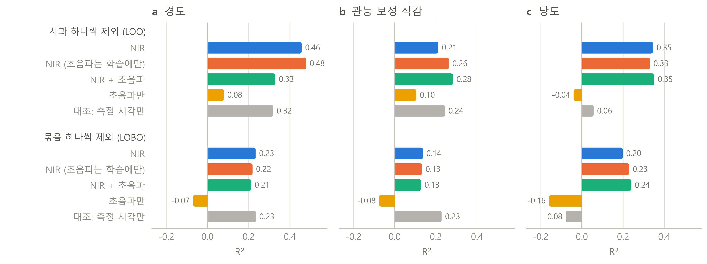
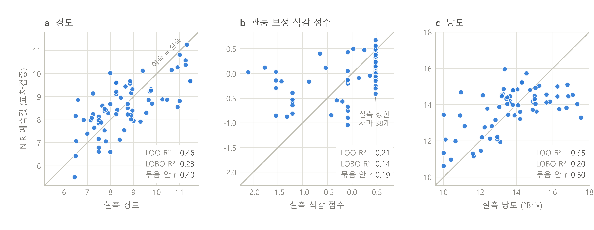
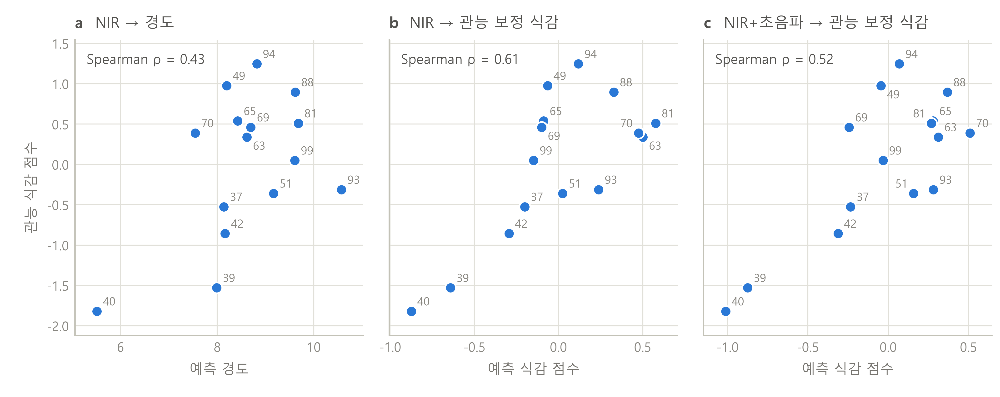
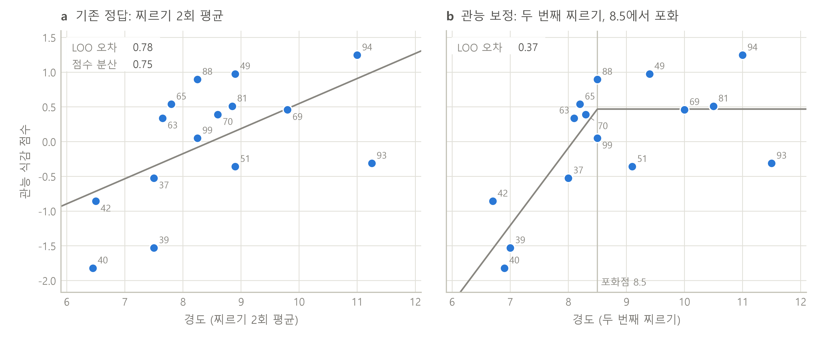

<div align="center">

# 🍎 사과 품질 비파괴 분석

**근적외선(NIR) 분광과 40 kHz 초음파로 사과의 경도·당도·식감을 예측하고,<br>현미경 사진에서 과육 세포를 자동으로 세는 분석 코드와 학습된 모델**


[핵심 결과](#-핵심-결과) · [구성](#-저장소-구성) · [세포 계수](#-세포-계수-모델) · [데이터 분석](#-데이터-분석) · [실행 방법](#-실행-방법)

</div>

---

## 📌 한눈에 보기

| 항목 | 내용 |
|---|---|
| **시료** | 홍로 사과 70개(31~100번), 10개씩 7묶음으로 측정 |
| **입력** | NIR 18채널 분광(AS7265x, 410~940 nm, 4방향 × 3회), 40 kHz 초음파 스윕(38.4~41.6 kHz) |
| **정답** | 경도(찌르기 2회), 당도(°Brix), 관능평가(푸석함·다즙성·아삭함, 사과 15개), 과육 세포 수 |
| **검증** | 사과 하나씩 제외(LOO)와 묶음 하나씩 제외(LOBO) 교차검증. 모든 선택은 학습 폴드 안에서만 |
| **세포 계수** | 자동 계수기 v11·v13b, 다른 공개 모델 6종보다 정확도·속도·안정성 모두 앞섬 |

---

## 📊 핵심 결과

<table>
<tr>
<td width="50%">

**NIR이 주력, 초음파는 단독으로 약함**

| 예측 대상 | NIR 교차검증 r | LOO R² |
|---|:---:|:---:|
| 경도 | **0.69** | 0.46 |
| 당도 (°Brix) | **0.59** | 0.35 |
| 관능 식감 점수 (ρ, 사과 15개) | **0.61** | – |
| 초음파 단독 (모든 대상) | < 0.6 | ≤ 0.10 |

- 560 nm 채널이 푸석함과 r 0.63(사과 15개)으로 이어집니다. 새 사과로 재확인이 필요한 단서입니다.
- 초음파를 학습에만 쓰거나 NIR과 합쳐도 NIR 단독보다 뚜렷하게 낫지는 않았습니다.

</td>
<td width="50%">



</td>
</tr>
</table>

<details>
<summary><b>그림 더 보기</b></summary>
<br>

**NIR 교차검증 예측값과 실측값**


**관능평가 사과 15개: 예측값과 관능 식감 점수**


**경도 정답의 관능 보정: 두 번째 찌르기, 8.5에서 포화**


</details>

---

## 🗂 저장소 구성

```text
.
├── analysis/                 데이터 분석 코드
│   ├── data_loader/          모든 분석이 데이터를 읽는 공통 진입점
│   ├── final_analysis/       NIR·초음파 → 경도·당도·관능 보정 식감 최종 모델, 새 사과 예측
│   ├── general_analysis/     종합 상관 분석과 보정, 푸석함 직접 예측
│   ├── sensory_water/        관능평가 정리, 패널 7 보정, 수분·당도와 NIR 확인
│   ├── cells_analysis/       세포 수 정리와 관능평가 비교
│   ├── ultrasound_features/  초음파 신호 처리, 품질 점검, 모델
│   ├── ultrasound_validation/ 초음파 원자료 독립 감사
│   └── manuscript/           원고용 그림과 LaTeX 표 생성
├── cell_counting/            세포 계수 코드
│   ├── v11/                  분할 기반 자동 계수기 (명령줄 도구 + 파이썬 패키지)
│   ├── v13b/                 v11 + 객체별 학습 분류(세포 아님·뭉침·1~3개)
│   └── review_pipeline/      본실험 사진 검토용 프로토콜 계수기
├── weights/                  학습된 모델 가중치
└── docs/figures/             README 그림
```

> 모든 파이썬 파일 맨 위에 그 파일이 하는 일을 영어 주석 세 문장 이내로 적어 두었습니다.

---

## 🔬 세포 계수 모델

염색한 사과 과육의 명시야 현미경 사진(10배 대물렌즈, 3840 × 2160 px)에서 세포를 셉니다.


### 벤치마크 (2026-11-10, 시험 사진 40장)

정답은 두 검토자가 따로 표시한 뒤 이견을 판정해 만들었습니다. 두 검토자끼리의 일치도는 F1 0.91로, 어떤 계수기든 넘기 어려운 실질적 상한입니다.

| 계수기 | 정확도 (평균 F1) | 속도 (초/장) | 안정성 (하위 10% F1) |
|---|:---:|:---:|:---:|
| **v11 (이 저장소)** | **0.867** | **0.10** | **0.789** |
| micro-SAM | 0.836 | 7.2 | 0.727 |
| Cellpose-SAM | 0.835 | 41.2 | 0.713 |
| Cellpose 3 | 0.821 | 6.3 | 0.713 |
| 기존 세트 3 파이프라인 | 0.815 | 11.7 | 0.746 |
| StarDist | 0.761 | 0.15 | 0.651 |
| Omnipose | 0.628 | 4.6 | 0.542 |
| InstanSeg | 0.563 | 9.9 | 0.399 |

속도는 같은 8코어 가상머신에서 잰 사진당 중앙값입니다.

### 모델 가중치

| 파일 | 크기 | 내용 |
|---|---:|---|
| `cell_counting/v11/cellcount/models/split_all.npz` | 1 KB | v11 분할 모델 (로지스틱 회귀, 두 몸체를 담은 마스크를 나눔) |
| `cell_counting/v11/cellcount/models/merge_all.npz` | 1 KB | v11 병합 모델 (한 몸체의 조각을 합침) |
| `weights/model_v13b.joblib` | 8.6 MB | v13b 객체 분류기 (HistGradientBoosting, 5분류, 보정 계수 α = 2.0) |
| `weights/pca_v13b.joblib` | 0.2 MB | v13b 임베딩 PCA 기저 (1024 → 48차원) |

- `model_v13b.joblib`은 scikit-learn 1.9.1로 저장했습니다. 다른 버전에서는 불러오지 못할 수 있습니다.
- ResNet-18 가중치는 torchvision이 ImageNet 공개 가중치를 내려받아 씁니다.
- `pca_v13b.joblib`은 원래 사진 60장의 임베딩으로 맞춘 기저입니다. 원래 계산은 새 사진을 포함해 PCA를 다시 맞추므로, 이 기저를 쓰면 일부 객체의 판정이 달라질 수 있습니다(상대 차이 약 2 %).

---

## 📈 데이터 분석

| 단계 | 코드 | 하는 일 |
|:---:|---|---|
| 1 | `analysis/ultrasound_features/` | 초음파 녹음을 주파수 구간별 전달 함수와 특징으로 변환, 반복성·드리프트 점검 |
| 2 | `analysis/sensory_water/` | 관능평가 코드 대응, 패널 7 빈칸·오타 보정, 수분·당도와 NIR 확인 |
| 3 | `analysis/final_analysis/s01` | 관능 식감 점수로 경도 정답 보정 |
| 4 | `analysis/final_analysis/s02~s05` | 중첩 교차검증, 순열 검정, 최종 적합, 진단 |
| 5 | `analysis/final_analysis/s06~s07` | 보고서·논문 그림 |
| 6 | `analysis/general_analysis/` | 종합 상관(472쌍), 신뢰도 보정, 푸석함 직접 예측 |
| 7 | `analysis/cells_analysis/` | 세포 수 표와 관능평가 비교 |

**모델 구성.** 특징 묶음 하나마다 릿지 회귀를 하나 두고, 각 학습 폴드 안에서 가장 좋은 1~3개의 평균을 고릅니다. 시험 사과는 자기 예측에 어떤 식으로도 관여하지 않습니다. 최종 모델은 모두 선형이라 `final_models.json`에 평균·척도·가중치·절편만 저장되고, `predict.py`가 이를 새 사과에 적용합니다.

---

## 🚀 실행 방법

### 설치

```bash
pip install -r requirements.txt
pip install torch torchvision   # v13b 임베딩 단계에만 필요
```

### 세포 계수 (v11)

```bash
python cell_counting/v11/count_cells.py 사진폴더/ --out 결과폴더/ --overlay
```

`summary.csv`에 사진별 세포 수와 피도가, `objects/`에 세포별 위치·크기가, `overlays/`에 확인용 그림이 저장됩니다. 사진 전체를 세려면 `--area full`을 붙입니다.

### 세포 계수 (v13b)

```bash
sh cell_counting/v13b/run_pipeline.sh 작업폴더   # 작업폴더/full/ 안에 .jpg 사진
```

결과는 `작업폴더/v13b/`에 사진별 표와 확인용 그림으로 저장됩니다.

### 데이터 분석

원자료는 이 저장소에 들어 있지 않습니다. 코드 안의 경로는 `C:/apple_project` 아래 폴더를 가리키니, 자료를 둔 위치로 바꿔서 실행하세요.

```bash
cd analysis/final_analysis
python s01_sensory_target.py && python s02_models.py && python s03_permutation.py
python s04_final_fit.py && python s05_diagnostics.py && python s06_figures.py
python predict.py nir_files.csv [us_table.csv]   # 새 사과 예측
```

---

<div align="center">
<sub>2026년 11월 · 사과 품질 비파괴 측정 연구</sub>
</div>
